<!-- 🎃 Hello-ween README for Aniket Singh. Replace aniketsingh1023 everywhere (Ctrl/Cmd+F). -->

  

  
  
  
  
  

  

<!-- ───────────────────────── PROJECTS ───────────────────────── -->

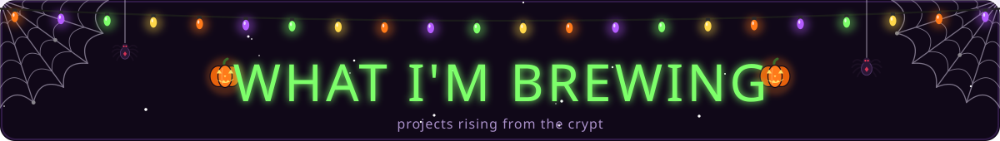

  <a href="https://undrift.anik8.me"></a>
  
  
  

<!-- ───────────────────────── SKILLS ───────────────────────── -->

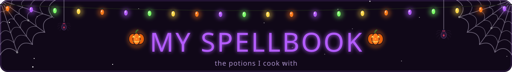

  

  

<!-- ───────────────────────── COMIC ───────────────────────── -->

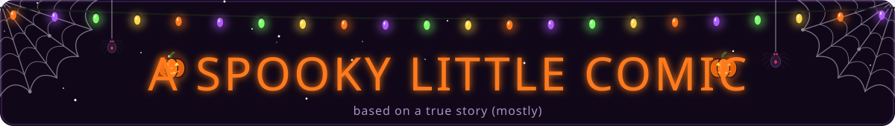

  

<!-- ───────────────────────── STATS ───────────────────────── -->

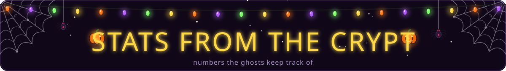

  
  

  

  

🕯️ <b>Psst… open for a spooky dev joke</b>

 
<blockquote>
  <b>Why did the developer go broke on Halloween?</b> 
  He used up all his <b>cache</b>. 💀
</blockquote>

  

